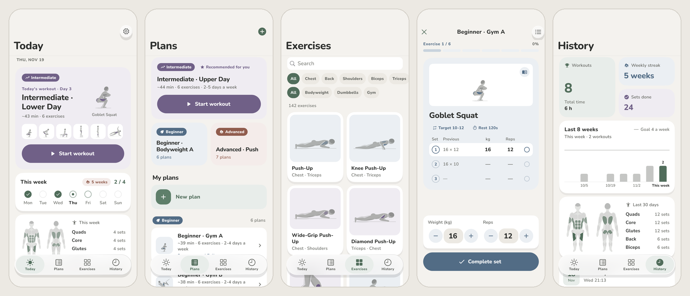
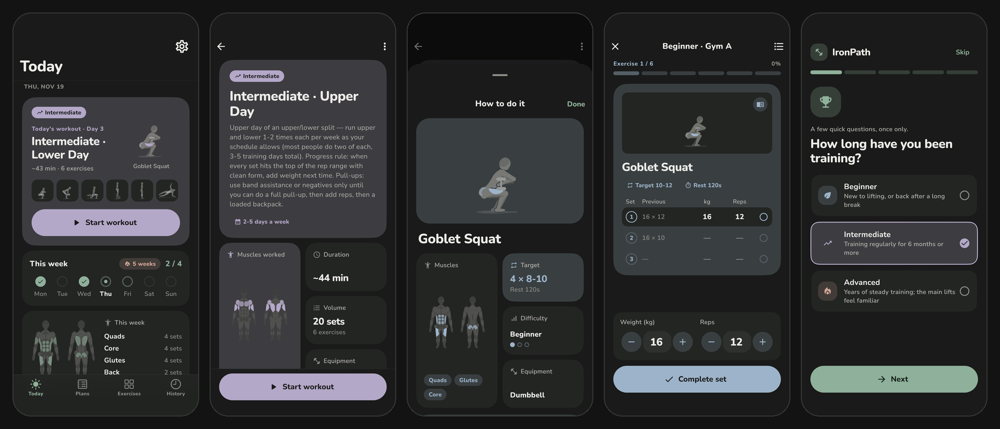

<div align="center">

# IronPath

**Offline-first, zero-account, ad-free workout trainer built with Flutter.**

[](LICENSE)
[](https://github.com/DanieleZ18/ironpath/actions/workflows/ci.yml)
[](https://github.com/DanieleZ18/ironpath/releases)

[English](README.md) · [简体中文](README.zh-CN.md)

</div>

---

IronPath is a calm, private strength-training companion with **no login, no cloud sync, no subscriptions, and no ads**. Beginners can follow structured built-in programs tailored to their equipment and schedule; experienced lifters can build custom plans and log every set like dedicated strength trackers.

<p align="center">
  
</p>
<p align="center">
  
</p>

## Highlights

- **100% Offline & Private** — All workouts, custom plans, and settings live locally on your device. No accounts, analytics, or network calls.
- **142 Exercises & 17 Built-in Plans** — Covers bodyweight (54), dumbbell (41), and gym/barbell/cable/machine (47) movements across Beginner, Intermediate, and Advanced tiers, with full English and Chinese coaching copy.
- **Procedural 2D Skeletal Animations (Zero Media Assets)** — Every single exercise is animated natively in Dart using a custom 2D two-bone IK rig, shaded anatomical silhouettes, and live primary/secondary muscle highlighting — no bundled videos, GIFs, or Lottie files.
- **Strength-App Session Logging** — Log each set inline (`Previous`, `kg`, `Reps`, `Done`) with thumb-reachable steppers, automatic prefill from previous sets, double-progression prompts, screen wakelock, rest timer ring (`-15s` / `+15s` / skip), and personal record detection.
- **Smart Personalization** — A skippable 4-question onboarding adapts recommendations to your experience, equipment, weekly training days, age band (`55+` automatically adds rest time and deload hints), and sensitive joints (warning chips + one-tap exercise swaps).
- **Anatomy Muscle Heat Maps & Progress Stats** — Front/back muscle heat maps for the current week, last 30 days, and each finished session, plus weekly streaks, an interactive 8-week chart, and per-exercise top-set trend lines.
- **Adaptive Craft & Dynamic Themes** — Morandi beige/charcoal light & dark palettes, Material You system accent colors on Android 12+, 6 curated presets, a contrast-safe custom hue slider, high-contrast accessibility support, and adaptive iOS/Android platform chrome.
- **Native Home-Screen Widgets** — Track your weekly goal and next workout right from the Android home screen or iOS Home / Lock Screen.

## Download

Pre-built Android APKs are published on the [GitHub Releases](https://github.com/DanieleZ18/ironpath/releases) page.

> **iOS users**: Build from source with Xcode (see below).

## Build from Source

### Prerequisites
- [Flutter SDK](https://docs.flutter.dev/get-started/install) (`>= 3.4.0` Dart SDK; tested with Flutter 3.47+)
- Android Studio / Android SDK (for Android) or Xcode (for iOS)

### Run Locally

```bash
git clone https://github.com/DanieleZ18/ironpath.git
cd ironpath
flutter pub get

# Run on a connected device or emulator
flutter run

# Or preview in Chrome
flutter run -d chrome
```

### Run Checks & Tests

```bash
flutter analyze
flutter test
```

### Build Release Artifacts

```bash
# Android APK
flutter build apk --release

# Split APKs by ABI
flutter build apk --release --split-per-abi

# Web
flutter build web --release
```

### iOS Widget Extension Setup (One-Time in Xcode)

The SwiftUI WidgetKit sources live in `ios/IronPathWidget/`. To enable the iOS Home & Lock Screen widget when building with Xcode:
1. Open `ios/Runner.xcworkspace` in Xcode.
2. **File → New → Target → Widget Extension**, name it `IronPathWidget` (uncheck *Include Configuration App Intent*).
3. Replace the generated files with `ios/IronPathWidget/IronPathWidget.swift`, `Info.plist`, and `IronPathWidget.entitlements`.
4. Add the App Group `group.io.github.danielez18.ironpath` under **Signing & Capabilities** for both `Runner` and `IronPathWidget` (matching `WidgetBridge.appGroup` in `lib/widget_bridge.dart`).

## Architecture & Docs

For deep dives into the codebase, procedural 2D IK animation rig, contrast-checked color system, and platform chrome, see:
- [Architecture & Design Notes](docs/architecture.md)
- [Illustration & Anatomy System](docs/illustration_system.md)
- [Changelog](CHANGELOG.md)

## Roadmap

- [ ] Local JSON backup & restore (export/import training logs and custom plans)
- [ ] Real scheduled workout reminders via `flutter_local_notifications`
- [ ] Additional languages & community translations
- [ ] Optional CSV export for training history

Contributions are welcome! See [CONTRIBUTING.md](CONTRIBUTING.md) to get started.

## Disclaimer

IronPath provides general fitness information and workout tracking tools only and is not a substitute for professional medical advice. Consult a qualified healthcare provider before starting any new exercise program, especially if you have existing injuries or medical conditions.

## License

IronPath is licensed under the **GNU General Public License v3.0** — see [LICENSE](LICENSE) for details.

The bundled **Nunito** Latin font (`assets/fonts/`) is licensed under the [SIL Open Font License 1.1](assets/fonts/OFL.txt).
