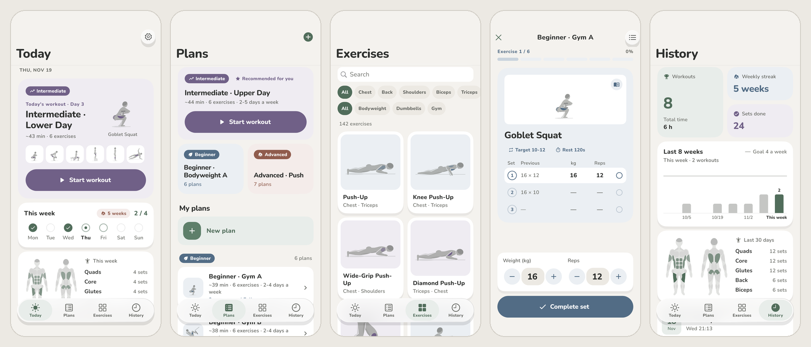
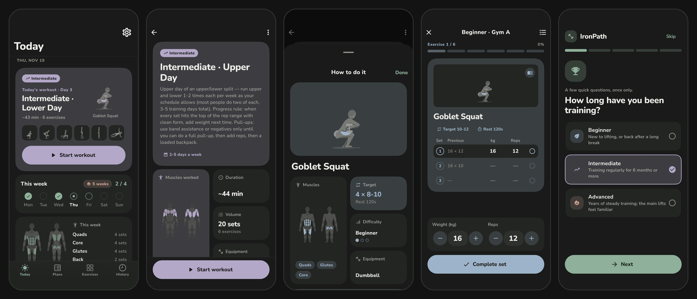

<div align="center">

# IronPath

**离线优先、无需登录、完全免费无广告的开源健身训练助手（Flutter）。**

[](LICENSE)
[](https://github.com/DanieleZ18/ironpath/actions/workflows/ci.yml)
[](https://github.com/DanieleZ18/ironpath/releases)

[English](README.md) · [简体中文](README.zh-CN.md)

</div>

---

IronPath 是一款克制、安静、完全本地化的力量训练伙伴——**无账号、无云端、无订阅、无广告**。新手可直接跟随匹配器械与频次的内置分化计划，进阶训练者可以自由编排自定义课表，并以专业力量训练软件的方式逐组记录每一次训练。

<p align="center">
  
</p>
<p align="center">
  
</p>

## 核心特性

- **100% 离线与隐私安全** — 所有训练记录、自定义计划和设置均保存在设备本地，无登录、无埋点、无网络请求。
- **142 个动作 & 17 套内置计划** — 涵盖徒手（54）、哑铃（41）与健身房器械/杠铃/绳索（47）三大类，按新手 / 进阶 / 高阶分级（新手计划刻意避开需要保护的杠铃卧推），配备完整中英双语指导文案。
- **纯代码 2D 骨骼 IK 动画（零图片/Lottie 资源）** — 全部 142 个动作均由 Dart 原生矢量骨骼引擎与两骨逆向运动学（IK）实时绘制，带肌肉轮廓光影与主/次发力肌群高亮。
- **专业力量训练逐组记录** — 类似 Strong / Hevy 的组表记录（上次成绩、重量、次数、完成状态），大拇指友好的步进加减、自动预填上次数据、双重渐进加重提示、训练屏幕常亮、圆环休息倒计时（±15 秒 / 跳过 / 提示音与震动）以及个人 PR 突破检测。
- **实用导向的个性化推荐** — 可跳过的 4 题引导问卷，直接驱动推荐算法与训练规则：按器械与每周训练天数匹配计划、55+ 年龄段自动增加 30 秒组间休息并提示减载周期、针对膝/肩/下背敏感部位提供禁忌警告与一键替换动作。
- **肌群热力图与进度统计** — 提供本周、近 30 天及单次完赛的正/背面解剖肌群热力图、连续训练周数、8 周交互柱状图以及单动作最佳组趋势折线。
- **柔和莫兰迪设计与跨端自适应** — 米纸浅色 / 炭黑深色双模式，支持 Android 12+ Material You 壁纸动态取色、6 套预设色盘、对比度自动约束的自定义色相滑块、系统高对比度适配，以及贴合 iOS 与 Android 原生习惯的交互组件。
- **原生桌面小组件** — 支持 Android 桌面小组件与 iOS 桌面 / 锁屏小组件，直接查看本周目标与下次训练内容。

## 下载安装

Android 预编译 APK 可直接在 [GitHub Releases](https://github.com/DanieleZ18/ironpath/releases) 页面下载。

> **iOS 用户**：请按下方说明通过 Xcode 从源码编译安装。

## 本地编译与运行

### 环境要求
- [Flutter SDK](https://docs.flutter.dev/get-started/install)（Dart SDK `>= 3.4.0`，已在 Flutter 3.47+ 验证）
- Android Studio / Android SDK（编译 Android）或 Xcode（编译 iOS）

### 启动应用

```bash
git clone https://github.com/DanieleZ18/ironpath.git
cd ironpath
flutter pub get

# 在已连接的真机或模拟器上运行
flutter run

# 或在 Chrome 中快速预览 Web 版
flutter run -d chrome
```

### 运行静态检查与测试

```bash
flutter analyze
flutter test
```

### 打包发布版本

```bash
# Android 通用 APK
flutter build apk --release

# 按 ABI 拆分的精简 APK
flutter build apk --release --split-per-abi

# Web 产物
flutter build web --release
```

### iOS 桌面小组件配置（Xcode 一次性步骤）

iOS SwiftUI WidgetKit 源码位于 `ios/IronPathWidget/`。如需启用 iOS 桌面与锁屏小组件：
1. 在 Xcode 中打开 `ios/Runner.xcworkspace`。
2. 选择 **File → New → Target → Widget Extension**，命名为 `IronPathWidget`（取消勾选 *Include Configuration App Intent*）。
3. 将生成的文件替换为仓库中的 `ios/IronPathWidget/IronPathWidget.swift`、`Info.plist` 和 `IronPathWidget.entitlements`。
4. 在 `Runner` 和 `IronPathWidget` 两个 Target 的 **Signing & Capabilities** 中同时添加 App Group：`group.com.daniele.ironpath`（需与 `lib/widget_bridge.dart` 中的 `WidgetBridge.appGroup` 保持一致）。

## 架构与设计文档

如果你想深入了解代码组织、纯代码 2D 骨骼 IK 动画引擎、对比度主题算法与跨端组件细节，请参阅：
- [架构与设计说明（英文）](docs/architecture.md)
- [插画与解剖肌群系统](docs/illustration_system.md)
- [更新日志](CHANGELOG.md)

## 后续计划

- [ ] 本地 JSON 数据备份与恢复（导入/导出训练记录与自定义计划）
- [ ] 基于 `flutter_local_notifications` 的真实定时训练提醒
- [ ] 更多语言本地化支持
- [ ] 训练历史 CSV 导出

欢迎提交 Issue 和 Pull Request！详情请阅读 [CONTRIBUTING.md](CONTRIBUTING.md)。

## 健康免责声明

IronPath 仅提供通用健身参考与训练记录工具，不构成任何医疗建议。开始新的运动计划前，尤其是存在既往伤病或健康问题时，请先咨询专业医生或康复师。

## 开源协议

本项目基于 **GNU General Public License v3.0 (GPL-3.0)** 开源，详见 [LICENSE](LICENSE)。

内置的 **Nunito** 拉丁字体（`assets/fonts/`）遵循 [SIL Open Font License 1.1](assets/fonts/OFL.txt)。
